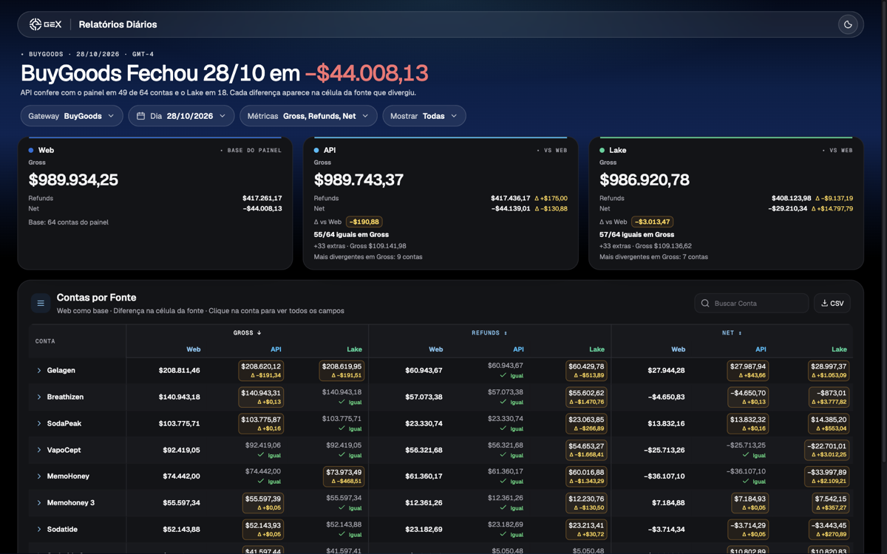

<p align="center"></p>

# Relatórios Diários de Gateways

Um JSON diário em USD por conta: BuyGoods e PagAmerican, cada um com Painel Web, API e Lake canônico, mais um diff contra o painel.

![Python][badge-python] ![uv][badge-uv] ![Playwright][badge-playwright] ![AWS Athena][badge-athena] ![Conventional Commits][badge-commits]



## Começo Rápido

Requisitos: `uv`/`uvx`, Google Chrome, Node.js (hooks) e perfil AWS somente leitura `canonico-validador-user` para Athena (`us-east-1`, workgroup `primary`). Configure `.env` com **nomes**, sem publicar valores: `BUYGOODS_LOGIN`, `BUYGOODS_PASSWORD`, `BUYGOODS_URL_CONTA_2`, `PAGAMERICAN_LOGIN`, `PAGAMERICAN_PASSWORD`, `PAGAMERICAN_API_KEY`. BuyGoods API usa ainda `credentials/buygoods_account_tokens.csv` (`account_id`, `account_name`, `token`).

```bash
npm install                    # ativa hooks locais
make buygoods DATE=2026-10-28 # exemplo: painel BuyGoods
make diff GATEWAY=buygoods DATE=2026-10-28 # após gerar web e api/lake
make painel                    # dados do painel HTML a partir dos diffs salvos
```

| Alvo                                                                  | Resultado                                            |
| --------------------------------------------------------------------- | ---------------------------------------------------- |
| `make buygoods` / `make buygoods-api` / `make buygoods-lake`          | JSON BuyGoods; Web também arquiva `.xls` ou `.xlsx`  |
| `make pagamerican` / `make pagamerican-api` / `make pagamerican-lake` | JSON PagAmerican; Web também arquiva `.xlsx`         |
| `make diff GATEWAY=buygoods\|pagamerican`                             | Compara API/Lake com Web; gera visões AI e Dashboard |
| `make painel`                                                         | Gera `mockups/painel.data.js` para o painel HTML     |

Todos os alvos aceitam `DATE=AAAA-MM-DD` (sem data: último dia completo no relógio do gateway) e `OUTPUT_ROOT=/caminho` (muda a raiz de `exports/`). Os seis alvos de extração aceitam `DEBUG=1`; só `make pagamerican` aceita `HEADED=1` para login manual inicial. Saídas: `exports/<gateway>/<source>/AAAA/MM/`; diff: `exports/<gateway>/diff/AAAA/MM/diff_ai_*.json` e `diff_dashboard_*.json`. Arquivos existentes de extração não são sobrescritos.

## O JSON

Mesmo contrato [`schemas/daily_report.schema.json`](schemas/daily_report.schema.json) nas seis combinações. Raiz: `gateway`, `report_date`, `currency: USD`, `source` e `contas` (chave slug por conta). **12 campos por conta:**

| Campo                   | Significado                         | Campo           | Significado                      |
| ----------------------- | ----------------------------------- | --------------- | -------------------------------- |
| `account_name`          | Nome da conta ou produto            | `gross_sales`   | Vendas após taxa da plataforma   |
| `shipping_and_handling` | Frete informado, já dentro de Gross | `commissions`   | Comissão de afiliado             |
| `refunds`               | Reembolsos atribuídos               | `chargebacks`   | Contestações atribuídas          |
| `commission_voids`      | Comissão estornada                  | `affiliate_epo` | (Comissões − estornos) / pedidos |
| `taxes`                 | Impostos líquidos                   | `aov`           | Gross / pedidos                  |
| `epo`                   | Net / pedidos                       | `net_sales`     | Resultado líquido                |

`net_sales = gross_sales − commissions − refunds − chargebacks − taxes + commission_voids`. Pedidos não são campo do JSON; o frete não é subtraído novamente.

## Fontes

| Gateway     | Dia D                                       | Conta                               | Aderência medida ao Painel Web                                                                               |
| ----------- | ------------------------------------------- | ----------------------------------- | ------------------------------------------------------------------------------------------------------------ |
| BuyGoods    | GMT-4; Web, API e Lake no mesmo dia         | Conta do painel, CSV ou `dim_conta` | **28/10/2026, 64 em comum:** API 49/64 contas iguais; Lake 18/64. API/Lake têm 33 contas secundárias extras. |
| PagAmerican | UTC; Web/API pelo checkout, Lake pela venda | Produto front do pedido             | **29/10/2026, 5 em comum:** API 5/5; Lake 3/5. Net Web: US$ 9.142,38, igual ao OnePager.                     |


Uma compra PagAmerican aberta às 23:53 de D e paga às 00:02 de D+1 pertence a **D** no Web/API e a **D+1** no Lake. Medições históricas não são aprovação de produção; limites e campos por fonte estão no [Guia Operacional](docs/guia.md).

## Diff

`make diff GATEWAY=pagamerican DATE=2026-10-29` lê JSONs já salvos, sem consultar fontes. Exige Web e pelo menos API ou Lake; compara campo a campo com tolerância de **US$ 0,01**. Status: `igual`, `divergente`, `faltando_na_fonte`, `extra_na_fonte`. `diff_ai_*.json` resume diferenças; `diff_dashboard_*.json` traz uma linha por conta × campo × fonte, inclusive iguais. Diffs podem ser reconstruídos após nova carga.


## Painel

`mockups/painel.html` é o mockup do painel diário: abre direto no navegador, sem servidor. `make painel` gera os dados dele (`mockups/painel.data.js`, fora do Git) com o último dia que tem diff em cada gateway; `BUYGOODS_DATE=` e `PAGAMERICAN_DATE=` escolhem outro dia.



O título traz o Net do dia; os cards de Web, API e Lake seguem a métrica escolhida e comparam as mesmas contas do painel, com as extras à parte. Na tabela, cada métrica vira três colunas, e a diferença aparece na célula da fonte que divergiu. O [Guia Operacional](docs/guia.md#painel-mockup-html) explica as regras.

## Desenvolvimento

```bash
make test # unittest, inclusive seletores Playwright no Chrome local
make lint # ruff check, ruff format --check e prettier --check
```

`npm install` ativa hooks Husky: lint-staged aplica Ruff e Prettier aos arquivos preparados, e commitlint exige mensagens [Conventional Commits](https://www.conventionalcommits.org/pt-br/v1.0.0/). O guia detalha configuração, cortes, fórmulas, cautelas e reexecução; `.env`, `credentials/` e `exports/` não entram no Git (planilhas podem conter dados pessoais).

[badge-python]: https://img.shields.io/badge/Python-1e6fd9?style=for-the-badge&logo=python&logoColor=white
[badge-uv]: https://img.shields.io/badge/uv-38bdf8?style=for-the-badge&logo=uv&logoColor=black
[badge-playwright]: https://img.shields.io/badge/Playwright-34d399?style=for-the-badge&logo=playwright&logoColor=black
[badge-athena]: https://img.shields.io/badge/AWS_Athena-1e6fd9?style=for-the-badge&logo=amazonaws&logoColor=white
[badge-commits]: https://img.shields.io/badge/Conventional_Commits-26272d?style=for-the-badge&logo=conventionalcommits&logoColor=white
