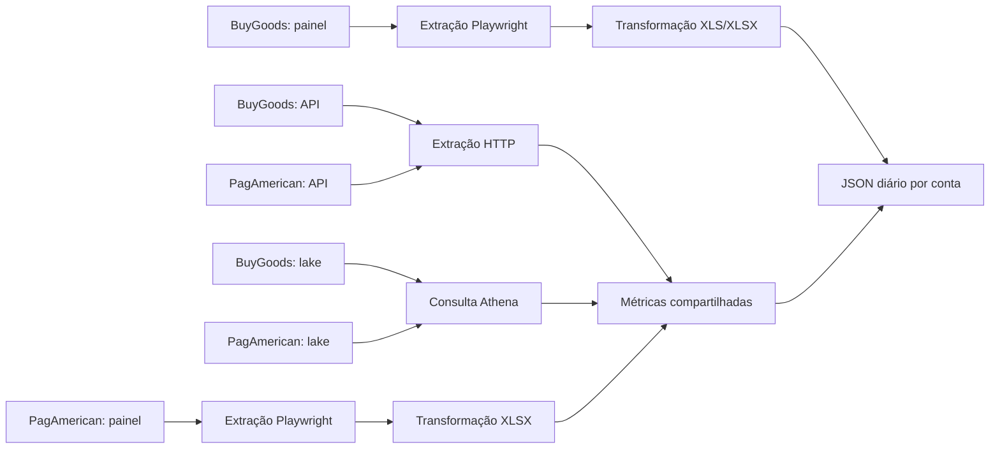

# Guia operacional dos relatórios diários

## Visão geral

Projeto gera JSON diário por conta, em USD, para **BuyGoods** e **PagAmerican**, cada um com três fontes independentes: painel web, API e lake canônico (Athena). Mesmo contrato em `schemas/daily_report.schema.json`; fontes podem divergir por corte temporal e disponibilidade dos dados.

## Pré-requisitos e configuração

- `uvx` disponível; `make` usa `uvx --with ... -- python` para dependências. Google Chrome instalado para Playwright (`channel="chrome"`), inclusive testes de seletores.
- AWS profile **somente leitura** `canonico-validador-user`, região `us-east-1`; consultas lake usam Athena workgroup `primary`, database `gex_db_prod_silver`. Não substituir pelo profile `default`.
- Na raiz do projeto, `.env` com **nomes** `BUYGOODS_LOGIN`, `BUYGOODS_PASSWORD`, `BUYGOODS_URL_CONTA_2` (painel BuyGoods); `PAGAMERICAN_LOGIN`, `PAGAMERICAN_PASSWORD` (painel PagAmerican); `PAGAMERICAN_API_KEY` (API PagAmerican; aceita também variável de ambiente). Não colocar valores em documentação ou versionamento.
- `credentials/buygoods_account_tokens.csv`: cabeçalhos obrigatórios `account_id`, `account_name`, `token`, uma linha por conta. Nunca versionar tokens. PagAmerican web mantém sessão em `~/.pagamerican-profile`, fora do projeto.

## Como rodar

Executar na raiz. Sem `DATE`, cada alvo usa o último dia completo **no relógio do gateway** (BuyGoods GMT-4, PagAmerican UTC), não o da máquina; caminhos abaixo usam `AAAA/MM` e data `AAAA-MM-DD` (dia D).

| Comando                                                     | Saída sob raiz do projeto (padrão)                                                             |
| ----------------------------------------------------------- | ---------------------------------------------------------------------------------------------- |
| `make buygoods DATE=AAAA-MM-DD`                             | `exports/buygoods/web/AAAA/MM/master_accounts_D.xls` ou `.xlsx`, mais `master_accounts_D.json` |
| `make buygoods-api DATE=AAAA-MM-DD`                         | `exports/buygoods/api/AAAA/MM/master_accounts_D.json`                                          |
| `make buygoods-lake DATE=AAAA-MM-DD`                        | `exports/buygoods/lake/AAAA/MM/master_accounts_D.json`                                         |
| `make pagamerican DATE=AAAA-MM-DD` (`HEADED=1` no 1º login) | `exports/pagamerican/web/AAAA/MM/pagamerican_D.xlsx` e `pagamerican_D.json`                    |
| `make pagamerican-api DATE=AAAA-MM-DD`                      | `exports/pagamerican/api/AAAA/MM/pagamerican_D.json`                                           |
| `make pagamerican-lake DATE=AAAA-MM-DD`                     | `exports/pagamerican/lake/AAAA/MM/pagamerican_D.json`                                          |
| `make test`                                                 | Testes unitários (`unittest discover -s tests -v`); não gera relatório                         |

`DATE` vale para os seis alvos e para `make diff`. `DEBUG=1` habilita logs detalhados em qualquer extração; `OUTPUT_ROOT=/caminho` desloca a raiz de `exports/` para `/caminho/exports/`; `HEADED=1` só vale para `pagamerican` (primeiro login manual ou sessão expirada). Exemplo: `make pagamerican-api DATE=2026-10-29 OUTPUT_ROOT=/tmp/reports DEBUG=1`. `.gitignore` mantém `.env`, `credentials/` e `exports/` fora do versionamento.

**Momento:** executar BuyGoods API para D depois de ~08:12 GMT-4 em D+1, quando fecha linha `Net` do ledger; antes disso pode falhar. PagAmerican API retém cerca de 10 dias; não confiar em backfill antigo. Lake depende de carga disponível; consulta sem linhas falha, não comprova zero vendas.

**Reexecução:** saída existente não é sobrescrita. API/lake retornam sem recalcular; web reaproveita planilha local, e BuyGoods ainda pode reutilizar export remoto. Para refazer JSON, **guardar cópia fora do caminho de saída e retirar somente JSON daquele dia**; web então transforma planilha existente. Para nova extração web, retirar também planilha do dia (depois de preservar cópia); PagAmerican gera nova entrada no histórico do painel. Para conservar snapshots diferentes sem tocar nos antigos, usar `OUTPUT_ROOT` distinto. No PagAmerican, eventos posteriores podem alterar o resultado de D numa nova extração.

## Contrato JSON

Objeto com `gateway` (`Buygoods` ou `Pagamerican`), `report_date` (`AAAA-MM-DD`), `currency` (`USD`), `source` (`web`, `api`, `lake`) e `contas`: mapa de chaves ASCII minúsculas em formato slug (`nome_da_conta`) para objetos por conta/produto. Colisão de chaves falha, não substitui conta. Campos monetários numéricos em USD; razões por pedido arredondadas a 2 casas e zeradas sem pedidos. `shipping_and_handling` é informativo: não subtrair novamente do Gross.

| Campo                   | Significado                                                                              |
| ----------------------- | ---------------------------------------------------------------------------------------- |
| `account_name`          | nome exibido da conta BuyGoods ou produto principal PagAmerican                          |
| `gross_sales`           | vendas menos taxa da plataforma/gateway                                                  |
| `shipping_and_handling` | frete cobrado informado pela fonte, já incluído em Gross onde aplicável                  |
| `commissions`           | comissão de afiliação                                                                    |
| `refunds`               | reembolsos atribuídos ao período conforme fonte                                          |
| `chargebacks`           | chargebacks atribuídos ao período conforme fonte                                         |
| `commission_voids`      | estornos de comissão; zero quando fonte não informa                                      |
| `affiliate_epo`         | (`commissions` − `commission_voids`) / pedidos                                           |
| `taxes`                 | impostos de venda líquidos das devoluções quando fonte as informa                        |
| `aov`                   | `gross_sales` / pedidos                                                                  |
| `epo`                   | `net_sales` / pedidos                                                                    |
| `net_sales`             | `gross_sales` − `commissions` − `refunds` − `chargebacks` − `taxes` + `commission_voids` |

Quantidade de pedidos **não é campo do JSON**. Visitors, Conversion Rate, EPC e Affiliate EPC não entram no contrato (API BuyGoods não oferece Visitors). Fórmula, validação, escrita atômica e data padrão por fuso ficam em `src/common/report.py` (`account_metrics`, `finalize_report`, `write_report`, `yesterday`).

## Fontes e critérios de atribuição

| Gateway / fonte  | Dia D, conta e campos                                                                                                                                                                                                                                                                                                                                                                                          | Pós-venda e limites                                                                                                                                                                                                                                                                                                                                                                                             |
| ---------------- | -------------------------------------------------------------------------------------------------------------------------------------------------------------------------------------------------------------------------------------------------------------------------------------------------------------------------------------------------------------------------------------------------------------- | --------------------------------------------------------------------------------------------------------------------------------------------------------------------------------------------------------------------------------------------------------------------------------------------------------------------------------------------------------------------------------------------------------------- |
| BuyGoods web     | Painel Master Accounts, dia D (GMT-4) escolhido em Custom Range; uma conta por linha. Importa métricas da planilha `.xls`/`.xlsx`, sem `Total` nem linhas com todas as métricas numéricas zeradas.                                                                                                                                                                                                             | Refunds/chargebacks conforme export do painel; planilha é referência de comparação. Export novo é conferido: a linha em Exports precisa cobrir D.                                                                                                                                                                                                                                                               |
| BuyGoods API     | Dia do ledger GMT-4; conta do CSV. Linha `Net` de `/transactions.php`: Gross = `sales` − `fees`, Commissions = `commissions`, Taxes = `sale_taxes` − `sale_tax_refunds`, Commission Voids = `commissions_voids`, S&H = `shipping_handling`. Pedidos: `user_id` + `sessid2` distintos em D em `/orders.php`, excluindo cancelamentos e testes.                                                                  | Refunds do ledger menos US$ 1 por refund emitido em D, contado em `/orders.php` por data `date_refunded`; Chargebacks do ledger. Só inclui conta com movimento. Pedidos podem superar painel por 1–2 em algumas contas.                                                                                                                                                                                         |
| BuyGoods lake    | Dia GMT-4: `dt_transacao_utc`/`dt_evento_utc` menos 4h, partições UTC D−1..D+1. Conta de `dim_conta`. Gross = `vl_coletado_usd` − `vl_taxa_gateway_usd`; Commissions = `vl_comissao_afiliado_usd`; Taxes = `vl_iva_usd` − IVA de refunds; S&H = `vl_frete_cobrado_usd`; pedidos = clientes (`id_cliente`) distintos. Não filtrar `fl_teste` nem cancelamentos: compras internas reais chegam com `fl_teste=1`. | Eventos **do dia do evento** D, inclusive de pedidos antigos. Refunds = `refund_total`, `refund_parcial`, `alerta_chargeback` (valor + IVA, sem multa); Chargebacks = `chargeback_*` (valor + IVA + multa); Commission Voids aproximados pela comissão de itens com chargeback em D. IVA de evento é estimado; eventos tardios podem chegar depois da janela e renovações sintéticas `-B00n` têm data inferida. |
| PagAmerican web  | Dia UTC D pelo **dia de abertura do checkout**; conta = produto da compra `Initial` do pedido em `Purchases`, incluindo upsells no mesmo pedido. `Orders`: Gross = `Order Amount` − `Creator Platform Fee`; Commissions = `Affiliation Amount`; Taxes = `Creator Tax`; pedidos = linhas. S&H e Commission Voids = 0.                                                                                           | `Refunds&Chargebacks`: valores absolutos `Refundamount`/`chargebackamount` dos **pedidos de D**, qualquer que seja a data do evento. Sheet vazia pode não existir. Reextração posterior pode aumentar esses valores.                                                                                                                                                                                            |
| PagAmerican API  | Dia UTC de `checkoutInitializedAt`, conta = produto `front` em `/purchases`; upsells ficam no pedido. Busca pedidos por data de criação (D..D+1) e filtra checkout em D. Gross = `amountTransaction` − `amountCreatorPlatformFee`; Commissions = `amountAffiliation`; Taxes = `amountCreatorTax`; pedidos = ordens. S&H e Commission Voids = 0.                                                                | `/refunds` e `/chargebacks` de D até hoje, vinculados aos **pedidos de D**, `amountRefundedTotal` em valor absoluto. `refundSource=alerta` em `/refunds` é ignorado; alerta em `/chargebacks` conta como chargeback, sem dupla contagem. Paginação incompleta gera erro; janela de criação pode não capturar checkout convertido mais de um dia depois.                                                         |
| PagAmerican lake | Dia UTC de venda `dt_dia = D`; conta = `nm_produto` do item `front` em `id_grupo_pedido`; sem front falha. Gross = `vl_coletado_usd` − `vl_taxa_gateway_usd`; Commissions = `vl_comissao_afiliado_usd`; Taxes = `vl_iva_usd`; S&H = `vl_frete_cobrado_usd` informativo; pedidos = grupos distintos; Commission Voids = 0.                                                                                      | Eventos ligados aos **pedidos vendidos em D**, a partir de D sem limite superior: `refund_*` (valor + IVA), `chargeback_*` e `alerta_chargeback` (valor + IVA + multa). Lake usa data da venda, painel/API usam checkout: pedidos perto da meia-noite podem cair em dias diferentes. Onboarding: `production_acceptance=false`; não tratar aderência histórica como aprovação de produção.                      |

**Aderência medida no README, não garantia para outra data:**

- BuyGoods API versus painel de **2026-10-28**, 64 contas em comum: Taxes, Chargebacks e Commission Voids **64/64** ao centavo; Commissions **63/64**; Refunds **62/64**; Gross **55/64**; Net **53/64**; AOV **57/64**. Contagem de pedidos **47/54**; API também inclui contas secundárias ausentes no login do painel.
- BuyGoods lake versus mesmo painel, 64 contas: Chargebacks **64/64**; Gross e Commissions **57/64**; Refunds e Commission Voids **46/64**; Taxes **34/64**; Net **29/64**. API e lake listam **97 contas**. Refunds do lake conferiram com `/orders.php` ao centavo para **449 pedidos** de duas contas; diferença para painel fica entre ledger e `/orders.php`.
- PagAmerican web: soma do Net bateu com OnePager NET REVENUE em **2026-10-29: US$ 9.142,38**. API conferiu com export web nessa data para classificação dos alertas, conforme README. Lake: **4 contas** bateram ao centavo com web; SodaPeak diferiu por pedido criado **00:02Z** em D com checkout em D−1. Não generalizar essa medição para produção.

## Manutenção

- `src/scripts/extracao_diaria_<gateway>_<fonte>.py`: coleta, cortes temporais, caminhos e CLI; `src/common/report.py`: fórmula do painel, schema, escrita e data padrão; `src/common/athena.py`: cliente Athena dos dois lakes; `src/transformations/`: leitura das planilhas web; `schemas/`: contratos; `tests/`: regressões; `exports/<gateway>/<fonte>/AAAA/MM/`: artefatos. `Makefile` mantém comandos e dependências; `README.md` guarda medições.
- Nova fonte: mapear campos para formato de ledger usado por `account_metrics`, definir **dia, conta, pedido e data de eventos** explicitamente, usar `finalize_report` e `write_report`, adicionar alvo Make e testes de corte/agrupamento/erros. Novo gateway: atualizar enum `gateway` no schema, além de script, transformação, comando, testes e guia. Não assumir que `source` enum ou semântica do dia pode ser reutilizada sem checar contrato.
- Rodar `make test` e `make lint` após mudança. Testes de seletores Playwright usam Chrome local; não fazem export real. Depois de `npm install`, os hooks do git formatam os arquivos do commit (ruff no Python, prettier em md/json) e recusam mensagens fora do Conventional Commits (commitlint). Config do ruff em `pyproject.toml`.
- BuyGoods web: painel tem controles ocultos duplicados e anchors sem role de link; usar `a[action="export"]:visible` e `a[action="add"]:visible`. Export pode chegar em `.xls` apesar de UI anunciar `.xlsx`; preservar extensão. `existing_local_export` procura **somente** `.xls`/`.xlsx`, nunca JSON sidecar.
- PagAmerican web: sessão expirada mantém URL `/reports` com mensagem de expiração, não redireciona; detectar botão `Generate report`. Os períodos do painel seguem o relógio do navegador e o backend usa só a data dos limites (o Yesterday dele exporta D e D+1 inteiros). O script clica `Yesterday` só para habilitar o botão, intercepta o POST de exportação e fixa **D 00:00Z..23:59:59.999Z** para qualquer `DATE`. Antes de salvar, confere que todo `Checkout Initialized At` da aba Purchases cai em D (pedido aberto 23:53 e pago 00:02 pertence a D). Não remover essas correções. Dataset sem registros não produz sheet.
- BuyGoods web: dia escolhido em `Custom Range` (caixas de mês/ano do calendário, clique duplo no dia, Apply); o botão do filtro precisa mostrar `Mon D, AAAA - Mon D, AAAA`.
- Lake canônico PagAmerican segue em onboarding; aprovação humana/produção é distinta de código, carga ou comparação histórica.
